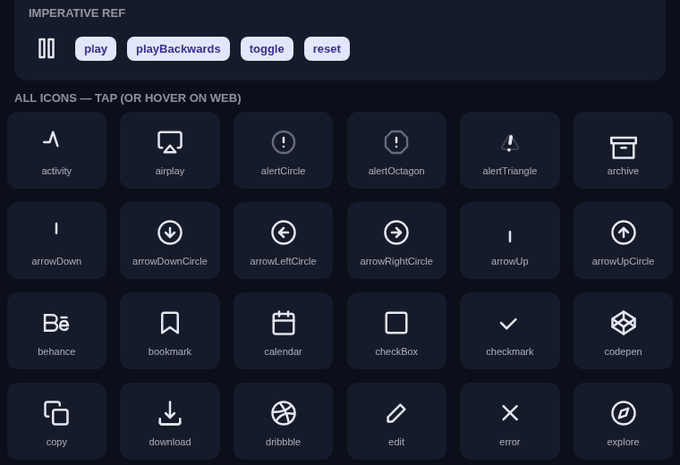
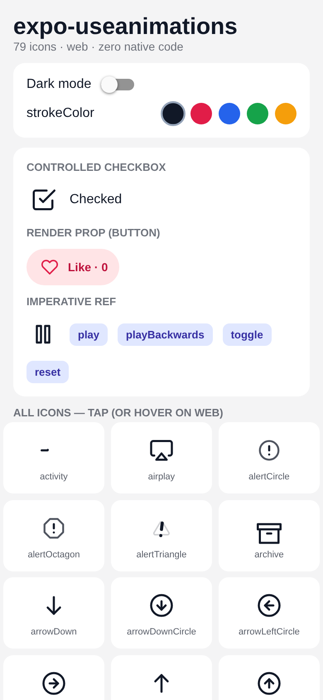
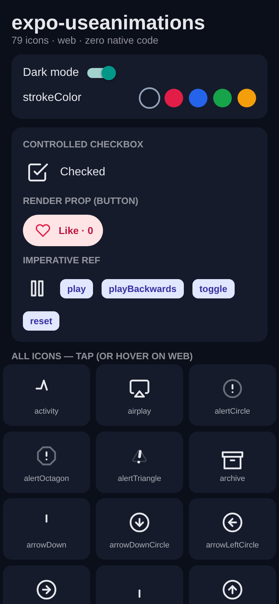
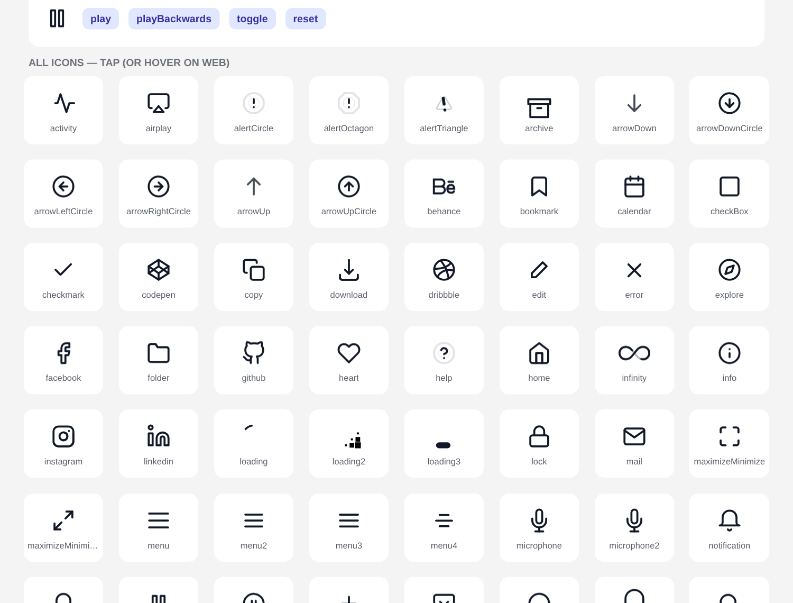

<h1 align="center">expo-useanimations</h1>

<p align="center">
  <b>79 animated micro-interaction icons for Expo &amp; React Native — iOS, Android and web.</b><br/>
  Works in <b>Expo Go</b> · ships with <b>EAS Update</b> · <b>zero native code</b>
</p>

<p align="center">
  <a href="https://www.npmjs.com/package/expo-useanimations"></a>
  
  
  
  
  <a href="./LICENSE"></a>
</p>

<p align="center">
  Created by <a href="https://binnicordova.com"><b>Binni Cordova</b></a> · <a href="https://binnicordova.com">BinniCordova.com</a> · <a href="https://github.com/binnicordova">@binnicordova</a>
</p>

---

## Get started in 3 steps

**1 — Install**

```sh
npx expo install expo-useanimations lottie-react-native
```

**2 — Import the icons you need**

```tsx
import UseAnimations from 'expo-useanimations';
import heart from 'expo-useanimations/lib/heart';
```

**3 — Render**

```tsx
<UseAnimations animation={heart} size={32} strokeColor="#e11d48" />
```

That's it. No `prebuild`, no config plugin, no development build — it runs in **Expo Go** on day one and every change ships over the air with `eas update`.

---

## See it running

<p align="center">
  
</p>

<table>
  <tr>
    <td align="center"><br/><sub>Light theme</sub></td>
    <td align="center"><br/><sub>Dark theme — <code>strokeColor</code> recolours every icon</sub></td>
  </tr>
</table>

<p align="center">
  <br/>
  <sub>The full catalog from the <a href="./example">example app</a> — tap (or hover on web) any icon.</sub>
</p>

---

## Real use cases

Every snippet below is copy-paste ready.

### ❤️ Like button in a feed

Optimistic like with a counter. `reverse` keeps the heart in sync with your data, even when the list re-renders or the post is liked from another screen.

```tsx
import { Pressable, Text } from 'react-native';
import UseAnimations from 'expo-useanimations';
import heart from 'expo-useanimations/lib/heart';

type Post = { id: string; likes: number; likedByMe: boolean };

export function LikeButton({ post, onToggleLike }: { post: Post; onToggleLike: (id: string) => void }) {
  return (
    <UseAnimations
      animation={heart}
      size={22}
      reverse={post.likedByMe}
      strokeColor={post.likedByMe ? '#e11d48' : '#71717a'}
      fillColor={post.likedByMe ? '#e11d48' : 'transparent'}
      onPress={() => onToggleLike(post.id)}
      accessibilityLabel={post.likedByMe ? 'Unlike' : 'Like'}
      render={(eventProps, icon) => (
        <Pressable {...eventProps} style={{ flexDirection: 'row', alignItems: 'center', gap: 6 }}>
          {icon}
          <Text>{post.likes}</Text>
        </Pressable>
      )}
    />
  );
}
```

### ⏳ Loading states while fetching

Looping icons autoplay — perfect for buttons and screens waiting on the network.

```tsx
import loading from 'expo-useanimations/lib/loading';

{isFetching ? (
  <UseAnimations animation={loading} size={28} strokeColor="#4f46e5" />
) : (
  <OrderList orders={data} />
)}
```

### ✅ Forms: terms checkbox & settings toggles

```tsx
import checkBox from 'expo-useanimations/lib/checkBox';
import toggle from 'expo-useanimations/lib/toggle';

<UseAnimations animation={checkBox} size={28} reverse={accepted} onPress={() => setAccepted((v) => !v)} />
<UseAnimations animation={toggle} size={40} reverse={notificationsOn} onPress={() => setNotificationsOn((v) => !v)} />
```

### 👁️ Show / hide password

```tsx
import { TextInput, View } from 'react-native';
import visibility from 'expo-useanimations/lib/visibility';

const [hidden, setHidden] = useState(true);

<View style={{ flexDirection: 'row', alignItems: 'center' }}>
  <TextInput secureTextEntry={hidden} style={{ flex: 1 }} placeholder="Password" />
  <UseAnimations animation={visibility} size={24} reverse={!hidden} onPress={() => setHidden((h) => !h)} />
</View>
```

### ☰ Drawer / menu button that morphs into ✕

```tsx
import menu from 'expo-useanimations/lib/menu';

<UseAnimations animation={menu} size={28} reverse={drawerOpen} onPress={toggleDrawer} />
```

### ▶️ Audio & video player controls

```tsx
import playPause from 'expo-useanimations/lib/playPause';
import skipForward from 'expo-useanimations/lib/skipForward';
import volume from 'expo-useanimations/lib/volume';

<UseAnimations animation={playPause} size={44} reverse={player.playing} onPress={() => (player.playing ? player.pause() : player.play())} />
<UseAnimations animation={skipForward} size={32} onPress={() => player.seekBy(15)} />
<UseAnimations animation={volume} size={28} reverse={player.muted} onPress={() => (player.muted = !player.muted)} />
```

### 📋 Copy to clipboard

```tsx
import * as Clipboard from 'expo-clipboard';
import copy from 'expo-useanimations/lib/copy';

<UseAnimations animation={copy} size={22} onPress={() => Clipboard.setStringAsync(inviteCode)} />
```

### 🔖 Save for later, 🔔 notifications, 🗑️ delete

```tsx
import bookmark from 'expo-useanimations/lib/bookmark';
import notification from 'expo-useanimations/lib/notification';
import trash from 'expo-useanimations/lib/trash2';

<UseAnimations animation={bookmark} reverse={article.saved} onPress={() => toggleSave(article.id)} />
<UseAnimations animation={notification} reverse={hasUnread} onPress={openInbox} />
<UseAnimations animation={trash} onPress={() => removeItem(item.id)} />
```

### 🌗 Dark mode in one line

```tsx
import { useColorScheme } from 'react-native';

const color = useColorScheme() === 'dark' ? '#f4f4f5' : '#18181b';
<UseAnimations animation={heart} strokeColor={color} />;
```

### 🎛️ Drive it from code (onboarding, tutorials, game UI)

```tsx
import UseAnimations, { type UseAnimationsHandle } from 'expo-useanimations';
import star from 'expo-useanimations/lib/star';

const ref = useRef<UseAnimationsHandle>(null);

<UseAnimations ref={ref} animation={star} size={48} disabled />;

ref.current?.play();          // first → last frame
ref.current?.playBackwards(); // last → first frame
ref.current?.toggle();        // flip between start / end state
ref.current?.reset();         // back to frame 0
```

---

## Why it works in Expo Go and with EAS Update

| Piece                       | Where it runs | Native code?                                                  |
| :-------------------------- | :------------ | :------------------------------------------------------------ |
| `expo-useanimations`        | all           | **None** — TypeScript only.                                   |
| Icon data                   | all           | Plain Lottie JSON inside your JS bundle.                      |
| Colouring (`strokeColor`…)  | all           | Rewrites the Lottie JSON in JS before rendering.              |
| `lottie-react-native`       | iOS / Android | Yes — but it is **already inside Expo Go** and every Expo SDK.|
| `lottie-web`                | web           | Pure JS (loaded lazily, SSR-safe).                            |

Nothing new is compiled into your binary, so adding this package, changing icons, colours or sizes can all be shipped with `eas update` to apps already in the stores.

---

## API

### Props

| Prop                   | Type                                      | Default     | Description                                                                                      |
| :--------------------- | :---------------------------------------- | :---------- | :----------------------------------------------------------------------------------------------- |
| `animation`            | `Animation`                               | —           | **Required.** An icon from `expo-useanimations/lib/<name>` (or your own Lottie JSON).            |
| `size`                 | `number`                                  | `24`        | Width and height.                                                                                |
| `strokeColor`          | `string`                                  | original    | Replaces every stroke colour. Any RN colour (`'#fff'`, `'rgb(…)'`, `'tomato'`…).                 |
| `fillColor`            | `string`                                  | original    | Replaces every fill colour.                                                                      |
| `reverse`              | `boolean`                                 | `false`     | End state for toggle icons (checked, open, playing…). Works as initial **or** controlled value.  |
| `autoplay`             | `boolean`                                 | preset      | `true` for looping icons (`loading`, `activity`…), otherwise `false`.                            |
| `loop`                 | `boolean`                                 | preset      | Same as above.                                                                                   |
| `speed`                | `number`                                  | `1`         | Playback speed multiplier.                                                                       |
| `effect`               | `AnimationEffect`                         | icon preset | Override how the icon reacts (see below).                                                        |
| `onPress`              | `(e) => void`                             | —           | Called after the built-in interaction. `onClick` is accepted as an alias.                        |
| `disabled`             | `boolean`                                 | `false`     | Disables built-in interactions (the `ref` API still works).                                      |
| `wrapperStyle` / `style` | `StyleProp<ViewStyle>`                  | —           | Style of the wrapping `Pressable`.                                                               |
| `render`               | `(eventProps, animation) => ReactElement` | —           | Render prop to provide your own wrapper (spread `eventProps` on your `Pressable`).              |
| `options`              | `object`                                  | —           | Escape hatch: extra `LottieView` props on native, extra `lottie-web` config on web.              |
| `pathCss`              | `string`                                  | —           | **Web only.** Raw CSS applied to the icon's `<path>` elements.                                   |
| `testID`, `accessibilityLabel` | `string`                          | icon name   | Testing & accessibility.                                                                         |

### Interaction presets

Each icon ships with the same behaviour as on [useanimations.com](https://useanimations.com):

| Effect                     | Web (mouse)                      | iOS / Android (touch)               | Example icons                     |
| :------------------------- | :------------------------------- | :---------------------------------- | :-------------------------------- |
| `CLICK_PLAY_AND_BACKWARDS` | click toggles forward / backward | tap toggles forward / backward      | `checkBox`, `menu`, `heart`       |
| `CLICK_PLAY`               | click plays once                 | tap plays once                      | `copy`, `download`, `mail`        |
| `CLICK_PLAY_AND_SEGMENTS`  | click plays frames 0–60          | tap plays frames 0–60               | `skipForward`, `skipBack`         |
| `HOVER_PLAY_AND_STOP`      | hover plays, leave resets        | tap plays once                      | `github`, `twitter`, `home`       |
| `HOVER_PLAY_AND_BACKWARDS` | hover plays, leave plays back    | press-in plays, release plays back  | `settings`, `trash`, `archive`    |
| `LOOP_PLAY`                | autoplays in a loop              | autoplays in a loop                 | `loading`, `activity`, `infinity` |

### All 79 icons

`activity` · `airplay` · `alertCircle` · `alertOctagon` · `alertTriangle` · `archive` · `arrowDown` · `arrowDownCircle` · `arrowLeftCircle` · `arrowRightCircle` · `arrowUp` · `arrowUpCircle` · `behance` · `bookmark` · `calendar` · `checkBox` · `checkmark` · `codepen` · `copy` · `download` · `dribbble` · `edit` · `error` · `explore` · `facebook` · `folder` · `github` · `heart` · `help` · `home` · `infinity` · `info` · `instagram` · `linkedin` · `loading` · `loading2` · `loading3` · `lock` · `mail` · `maximizeMinimize` · `maximizeMinimize2` · `menu` · `menu2` · `menu3` · `menu4` · `microphone` · `microphone2` · `notification` · `notification2` · `playPause` · `playPauseCircle` · `plusToX` · `pocket` · `radioButton` · `scrollDown` · `searchToX` · `settings` · `settings2` · `share` · `skipBack` · `skipForward` · `star` · `thumbUp` · `toggle` · `trash` · `trash2` · `twitter` · `userMinus` · `userPlus` · `userX` · `video` · `video2` · `visibility` · `visibility2` · `volume` · `youtube` · `youtube2` · `zoomIn` · `zoomOut`

Need them all at once (a picker, a showcase)?

```tsx
import UseAnimations, { animationKeys } from 'expo-useanimations';
import animations from 'expo-useanimations/all'; // ⚠️ bundles all 79 icons

animationKeys.map((key) => <UseAnimations key={key} animation={animations[key]} />);
```

### Your own Lottie files

```tsx
import type { Animation } from 'expo-useanimations';
import rocketJson from './rocket.json';

const rocket: Animation = { animationKey: 'rocket', animationData: rocketJson, effect: 'CLICK_PLAY' };

<UseAnimations animation={rocket} size={64} />;
```

---

## Example app

[`example/`](./example) is a plain Expo SDK 58 app (no `ios/` or `android/` folders) that runs in **Expo Go** and consumes the library straight from `src/` with hot reload.

```sh
git clone https://github.com/binnicordova/expo-useanimations.git
cd expo-useanimations && bun install
cd example && bun install
bun run ios       # iOS Simulator (Expo Go)
bun run android   # emulator or USB device (Expo Go)
bun run web       # browser
```

## Development

```sh
bun install
bun run typecheck   # tsc --noEmit
bun run lint        # eslint
bun run test        # jest (jest-expo)
bun run build       # emits build/ (JS + .d.ts)
```

Icon entry points in `src/lib/*` are generated from the official `react-useanimations` package:

```sh
bun add react-useanimations@latest
# add "<iconName>": "<EFFECT>" to scripts/effects.json
bun run generate
```

Publishing: `bun run prepublishOnly && npm publish`.

---

## About the creator

**expo-useanimations** is designed and maintained by **[Binni Cordova](https://binnicordova.com)** — mobile engineer focused on Expo and React Native apps that ship fast and feel great.

- 🌐 Website: **[BinniCordova.com](https://binnicordova.com)**
- 🐙 GitHub: **[@binnicordova](https://github.com/binnicordova)**

If this package saves you time, ⭐ the repo and share it — it genuinely helps.

## Credits & license

- Animations are designed by **[useAnimations](https://useanimations.com)** and are consumed from the official [`react-useanimations`](https://www.npmjs.com/package/react-useanimations) package — this package does **not** copy or redistribute the animation files. The artwork is licensed by useAnimations under **[CC BY 4.0](https://creativecommons.org/licenses/by/4.0/)** with [their own terms](https://github.com/useAnimations/react-useanimations/blob/master/LICENSE); **credit / link to [useanimations.com](https://useanimations.com)** in apps that use it.
- The `expo-useanimations` source code (component, players, colouring, types, tooling) is **MIT** © [Binni Cordova](https://binnicordova.com) — see [LICENSE](./LICENSE).
